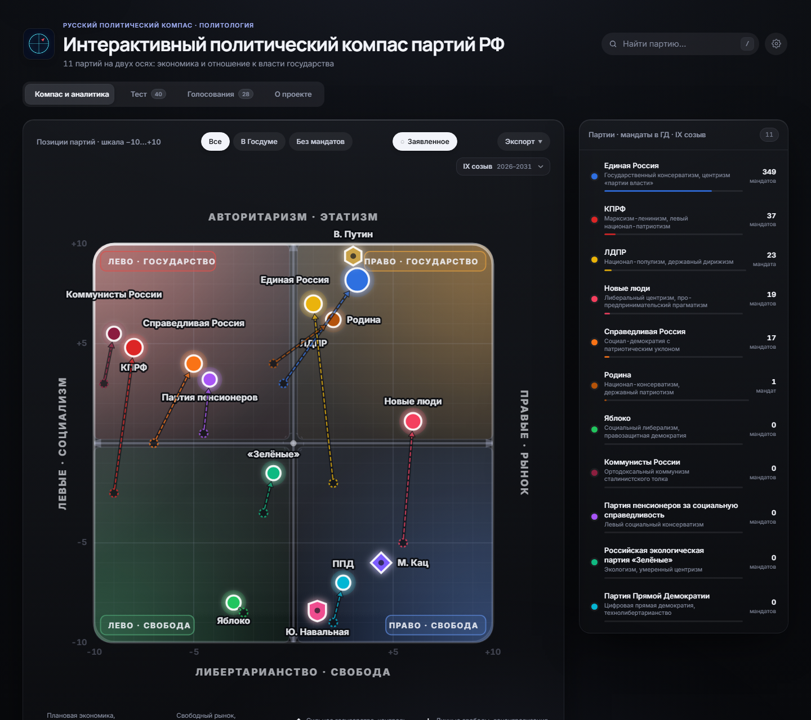
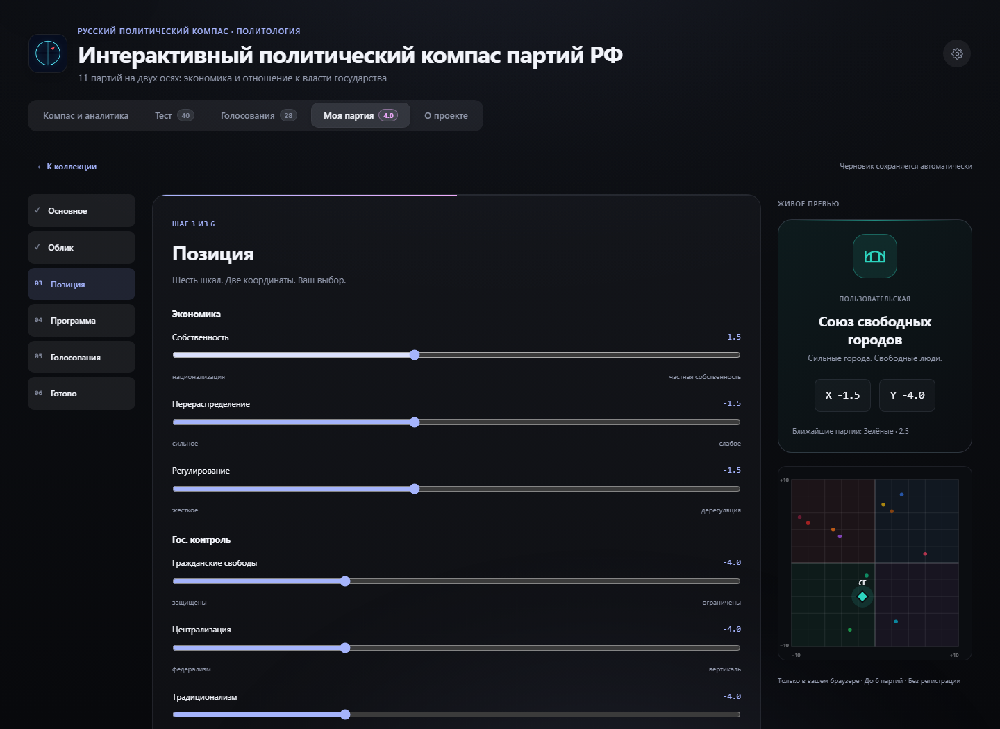
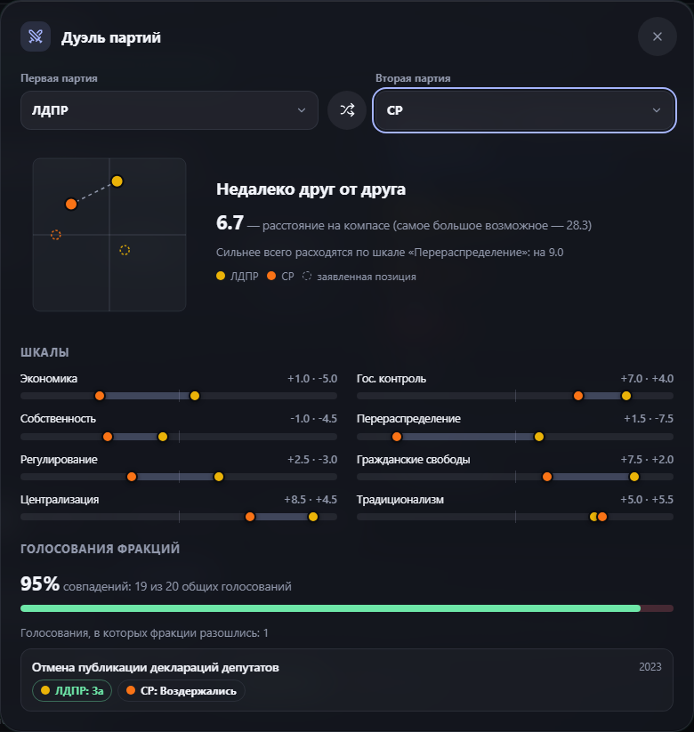
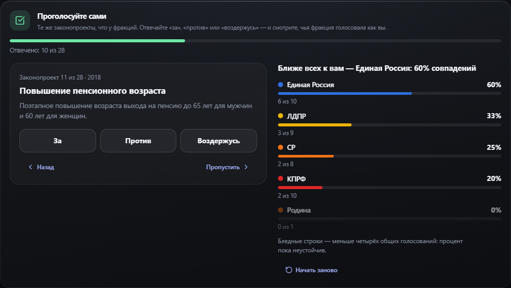
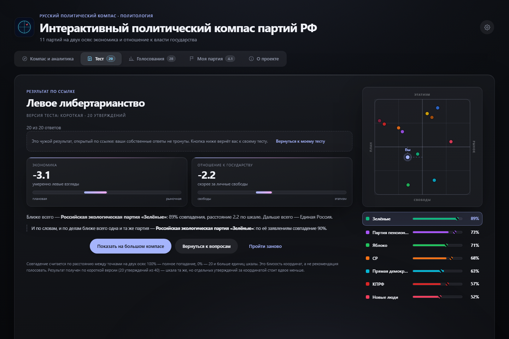
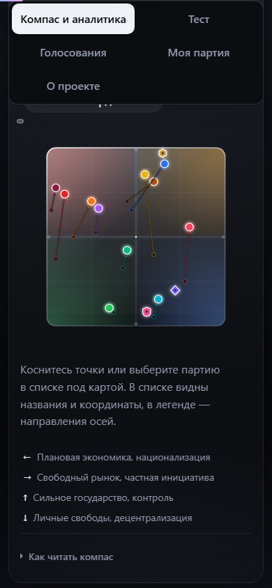

# Политический компас партий РФ

**Где находятся российские партии — по словам и по делам.** Интерактивная карта, парламентская аналитика и тест политических взглядов в одном статическом приложении.

[Открыть сайт](https://rupolitcompass.website) · [English interface](https://rupolitcompass.website/?lang=en) · [История изменений](CHANGELOG.md)

**Текущая версия — 4.4 «Тиса»** · Русский и английский интерфейс · Исходники без сборки, публикация пакетом



## Что можно сделать

| Раздел | Возможности |
| --- | --- |
| Компас | Сравнить 11 партий по экономике и отношению к государственной власти; посмотреть реальные и заявленные позиции, карточки и политических деятелей. Устроить дуэль двух партий: расстояние, восемь шкал и законопроекты, по которым разошлись их фракции. |
| Аналитика | Переключить IV–IX созывы, изучить распределение 450 мандатов, динамику состава Думы и профили по шести под-осям. |
| Коалиции | Собрать набор фракций и увидеть большинство, центр тяжести и показатели выбранной группы. |
| Голосования | Изучить 28 законопроектов 2004–2025 годов и сравнить позиции фракций. Проголосовать самим и узнать, чья фракция голосовала как вы. |
| Тест | Ответить на 20, 40 или 90 утверждений; получить координаты, разбор ответов и сравнение с партиями. |
| Моя партия | Создать до шести партий с нуля, из шаблона идеологии, из реальной партии или случайно: эмблема, программа, восемь шкал и голосования. Поставить на компас, поделиться ссылкой, провести гипотетические выборы в Госдуму или собрать палату. |
| О проекте | Методика, ответы на частые вопросы и интерактивное дерево всех версий проекта по веткам. |
| Экспорт | Сохранить компас в PNG или SVG, данные — в CSV или JSON; поделиться ссылкой на результат теста. |

Шесть тем оформления, системная тема, настройки читаемости, управление с клавиатуры и адаптивная вёрстка доступны в обоих языках интерфейса. С 4.3 опубликованный сайт после первого визита открывается и без интернета, а значки интерфейса собраны из одного набора [Lucide](https://lucide.dev) (ISC).

## Как выглядит проект

### Моя партия

Лаборатория в стиле проекта: шесть шагов, живое превью и своя точка среди реальных партий. Данные сохраняются в браузере; гостевая ссылка ничего не записывает без нажатия «Сохранить к себе».



### Дуэль партий и «Голосую сам»

С 4.3 две партии можно сравнить в одном окне — по позициям, шкалам и голосованиям фракций, а по 28 законопроектам — проголосовать самому и увидеть, чья фракция голосовала так же. С 4.4 дуэль открывается по ссылке вида `#/duel/er-kprf`, сравнивает и свои партии, а «Голосую сам» можно ограничить одной темой; дуэль и этот блок подгружаются, только когда понадобились.





### Результат теста

Координаты сопровождаются объяснением расчёта и списком ближайших партий. На скриншоте — демонстрационные ответы, а не результат автора проекта.



### На телефоне

С версии 4.1 на телефоне сайт устроен как приложение: нижняя панель вкладок, крупные заголовки разделов и нижние листы, которые смахиваются вниз.



Скриншоты обновлены для версии 4.3 с локально запущенного сайта. Партия и результат теста демонстрационные.

## Запустить локально

Нужен Node.js 22 или новее. Установка пакетов для запуска и модульных тестов не требуется.

```sh
git clone https://github.com/Arbuzyakaby/Russian-Political-Compass.git
cd Russian-Political-Compass
npm run serve
```

Откройте [localhost:4173](http://localhost:4173). Для запуска исходников сборка и установка зависимостей не нужны: приложение состоит из HTML, CSS и JavaScript. При публикации GitHub Actions объединяет и минифицирует файлы, проверяет пакет и отправляет его в GitHub Pages.

```sh
npm test
```

Браузерные проверки запускаются отдельно; подготовка описана в [руководстве разработчика](docs/DEVELOPMENT.md#проверки). Ширина страницы при тексте 200% на 320 px проверяется командой `npm run check:fonts`.

## Документация

| Документ | Что внутри |
| --- | --- |
| [Руководство пользователя](docs/USER_GUIDE.md) | Разделы сайта, тест, ссылки, экспорт и локальное хранение. |
| [Методология](docs/METHODOLOGY.md) | Оси, экспертные оценки, формулы теста и ограничения сравнения. |
| [Разработка](docs/DEVELOPMENT.md) | Архитектура, запуск, тесты, переводы и обновление данных. |
| [Выпуск обновлений](docs/RELEASING.md) | Версия, окно изменений, проверки, коммит и тег. |
| [Проверки релиза 4.4](docs/RELEASE_4_4.md) | Тесты до и после, размер пакета, замер запуска, проверка шрифтов, ограничения проверки. |
| [Проверки релиза 4.3](docs/RELEASE_4_3.md) | Тесты до и после, снятие `!important`, размер пакета, иконки, ограничения проверки. |
| [Проверки релиза 4.2](docs/RELEASE_4_2.md) | Тесты, сравнение вёрстки до и после, размер пакета и ограничения. |
| [Проверки релиза 4.1](docs/RELEASE_4_1.md) | Тесты, аудит выпуска и ограничения проверки. |
| [Проверки релиза 4.0](docs/RELEASE_4_0.md) | Сравнение скорости, браузерные сценарии и ограничения проверки. |
| [История версий](CHANGELOG.md) | Полный архив изменений проекта. |

## Данные и ограничения

Координаты партий — экспертные оценки. Они помогают сравнивать позиции, но не являются объективным измерением или рекомендацией, за кого голосовать. Процент совпадения в тесте вычисляется из расстояния на карте; это не вероятность поддержки партии.

Исторический созыв меняет данные о мандатах, но не превращает текущие координаты партий в исторические. Отсутствие фракции и отсутствие сведений о её голосовании показаны разными состояниями. Подробнее — в [методологии](docs/METHODOLOGY.md).

## Участие и лицензия

Об ошибках и предложениях можно сообщить через [Issues](https://github.com/Arbuzyakaby/Russian-Political-Compass/issues). Для изменения данных приложите источник и объяснение; для изменения интерфейса — шаги воспроизведения и, если уместно, скриншот.

Проект распространяется по [CC BY 4.0](LICENSE). Значки интерфейса — [Lucide](https://lucide.dev), лицензия ISC (текст — в [assets/icons/LICENSE](assets/icons/LICENSE)). При использовании материалов указывайте авторство, ссылку на проект и внесённые изменения.
